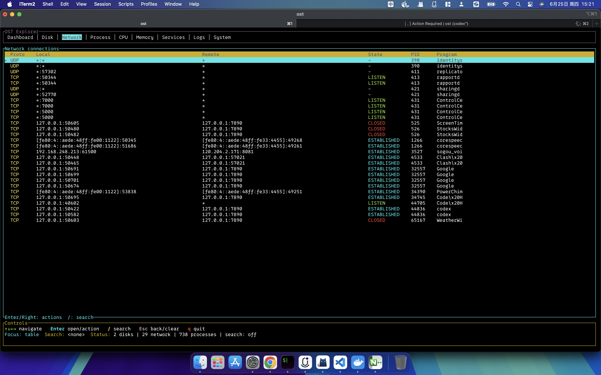

# OST

**A keyboard-driven system explorer for macOS.**

[](https://github.com/leebin-try/ost/releases/latest)
[](#platform-support)
[](https://www.rust-lang.org/)

[Installation](#installation) · [Views](#views) · [Keyboard reference](#keyboard-reference) · [Development](#development) · [简体中文](README.zh-CN.md)

OST brings system metrics, files, network connections, processes, services, and logs into one terminal interface. Start with the dashboard, switch to a focused view, and inspect or act on the selected item without leaving your terminal.



*Network view on macOS. Connection details and available actions depend on the current user's permissions.*

## Highlights

- **Nine focused views** — dashboard, disks, network, processes, CPU, memory, services, logs, and system information.
- **Keyboard navigation** — switch views, filter rows, explore folders, and open contextual actions.
- **Live system metrics** — CPU, memory, and process data refresh every three seconds; network connections refresh every eight seconds.
- **Responsive startup** — the interface renders before initial scans; network, service, and log collection run in background workers.
- **Contextual actions** — copy details, manage files, and terminate selected processes with confirmation.
- **Native system tools** — integrates with `lsof`, `netstat`, `launchctl`, `log`, and `pbcopy` on macOS.

## Installation

### Download for Intel Mac

Download the executable from [Releases](https://github.com/leebin-try/ost/releases/latest), or run the current release from your terminal:

```bash
curl -fLO https://github.com/leebin-try/ost/releases/download/v0.1.1/ost-v0.1.1-darwin-x86_64
chmod +x ost-v0.1.1-darwin-x86_64
./ost-v0.1.1-darwin-x86_64
```

Release downloads also include a `.tar.gz` archive and its SHA-256 checksum file. The published executable targets **macOS x86_64**.

### Install from source

With a current stable [Rust toolchain](https://www.rust-lang.org/tools/install) installed:

```bash
cargo install --git https://github.com/leebin-try/ost.git --tag v0.1.1 --locked
ost
```

Cargo installs the executable into `~/.cargo/bin` by default. Make sure that directory is on your `PATH`.

For Apple silicon, build from source using a native Rust toolchain; there is currently no prebuilt Apple silicon release.

## Quick start

1. Launch `ost` in an interactive terminal. The dashboard is selected initially.
2. Press `1`–`9` to jump to a view, or use `Tab` / `Shift+Tab` to cycle through views.
3. Press `↓` to focus the table, then select a row with the arrow keys.
4. Press `Enter` to explore a folder or open contextual actions. Press `→` on a table row to open its action menu.
5. Press `/` to filter the current view, or `q` to quit.

The top tabs have focus at startup. While the tabs are focused, `←` / `→` switch views; `↓` or `Enter` moves focus into the table.

## Views

| Key | View | Information and actions |
| --- | --- | --- |
| `1` | Dashboard | CPU, memory, swap, disk usage, top processes, and system overview. |
| `2` | Disk | Mounted volumes and folder contents; create, rename, copy, move, or delete files and folders. |
| `3` | Network | TCP/UDP connections, endpoints, state, and owning processes when available; copy connection details or ports. |
| `4` | Process | Processes sorted by CPU usage, with PID, memory, and status; terminate a selected process. |
| `5` | CPU | Overall and per-core CPU usage. |
| `6` | Memory | Physical memory and swap usage. |
| `7` | Services | Service details from `launchctl`; copy a PID or terminate the associated process when available. |
| `8` | Logs | Recent system log output, subject to system permissions. |
| `9` | System | OS, kernel, hostname, uptime, and boot time. |

## Keyboard reference

| Key | Action |
| --- | --- |
| `Tab` / `Shift+Tab` | Next / previous view. |
| `1`–`9` | Jump directly to a view. |
| `↑` / `↓` | Move through rows. Moving up from the first row focuses the tabs. |
| `Shift+↑` / `Shift+↓` | Move five rows at a time. |
| `PageUp` / `PageDown` | Move by a page. |
| `Home` / `End` | Select the first / last row. |
| `Enter` | Enter a folder or open contextual actions; activate the selected menu item. |
| `→` | Open contextual actions when the table is focused. |
| `←` | Go up a folder in Disk view, move to the previous view elsewhere, or close a dialog. |
| `/` / `s` | Open search; enter keywords and press `Enter` to filter rows. |
| `Esc` | Close a dialog, go up a folder, or clear the filter, depending on context. |
| `r` / `R` | Request a refresh of system data. |
| `q` | Quit from the main interface; close an open action menu. |
| `Ctrl+C` | Quit from any view or dialog. |

Search matches all supplied keywords, ignoring case. Submit an empty search to remove the filter.

## System integration

OST reads system metrics through [`sysinfo`](https://github.com/GuillaumeGomez/sysinfo). Its terminal interface uses [`ratatui`](https://github.com/ratatui/ratatui) and [`crossterm`](https://github.com/crossterm-rs/crossterm).

| Integration | macOS data source |
| --- | --- |
| Network connections | `lsof -nP -iTCP -iUDP`, with `netstat -anv` as a fallback. |
| Services | `launchctl list`. |
| Logs | `log show --last 5m --style compact`, displaying up to 200 recent lines. |
| Clipboard | `pbcopy`, with an internal buffer if the system clipboard is unavailable. |

OST runs with your current user's permissions. Some process details, logs, or actions may be unavailable. The Services view can terminate an associated process; it does not change the service's launch configuration.

File deletion is permanent and does not use the Trash. Deleting files or terminating processes requires confirmation in the interface.

## Platform support

**macOS is the primary platform.** Release binaries are currently provided for Intel Macs. Source builds use the architecture of your Rust toolchain.

The source includes Linux integrations for `systemctl`, `journalctl`, and `wl-copy` / `xclip`. Linux support is experimental, and no Linux release binary is currently published.

## Development

```bash
git clone https://github.com/leebin-try/ost.git
cd ost
cargo run --locked
```

Build an optimized executable:

```bash
cargo build --release --locked
./target/release/ost
```

Before submitting a change:

```bash
cargo fmt --check
cargo check --locked
cargo test --locked
```

## Feedback and contributions

Use [Issues](https://github.com/leebin-try/ost/issues) for bugs and feature requests. Include your OST version, macOS version, CPU architecture, terminal application, and steps to reproduce the issue. Remove personal paths or connection details from screenshots before sharing them.

Pull requests are welcome. Keep changes focused, describe the resulting behavior, and include the checks you ran.
