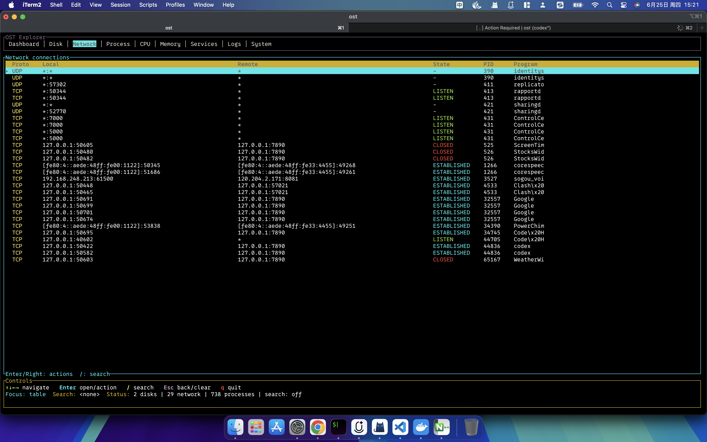

# OST

**面向 macOS 的键盘驱动终端系统浏览器。**

[](https://github.com/leebin-try/ost/releases/latest)
[](#平台支持)
[](https://www.rust-lang.org/)

[安装](#安装) · [功能视图](#功能视图) · [快捷键](#快捷键) · [开发](#开发) · [English](README.md)

OST 将系统指标、文件、网络连接、进程、服务和日志整合到同一个终端界面。从仪表盘了解系统状态，切换到具体视图查看详情，通过上下文菜单执行操作。



*macOS 网络视图。连接信息和可用操作取决于当前用户的系统权限。*

## 核心功能

- **九个视图**：仪表盘、磁盘、网络、进程、CPU、内存、服务、日志和系统信息。
- **键盘操作**：切换视图、筛选条目、浏览目录和执行上下文操作。
- **实时指标**：CPU、内存和进程每三秒刷新，网络连接每八秒刷新。
- **后台采集**：先显示界面，再加载初始数据；网络、服务和日志采集在后台线程执行。
- **上下文菜单**：复制详情、管理文件，以及经确认后终止进程。
- **系统集成**：在 macOS 上使用 `lsof`、`netstat`、`launchctl`、`log` 和 `pbcopy`。

## 安装

### Intel Mac 下载运行

从 [Releases](https://github.com/leebin-try/ost/releases/latest) 下载可执行文件，或在终端运行：

```bash
curl -fLO https://github.com/leebin-try/ost/releases/download/v0.1.1/ost-v0.1.1-darwin-x86_64
chmod +x ost-v0.1.1-darwin-x86_64
./ost-v0.1.1-darwin-x86_64
```

Release 同时提供 `.tar.gz` 压缩包及其 SHA-256 校验文件。目前发布的可执行文件面向 **macOS x86_64**。

### 从源码安装

安装当前稳定版 [Rust 工具链](https://www.rust-lang.org/tools/install) 后运行：

```bash
cargo install --git https://github.com/leebin-try/ost.git --tag v0.1.1 --locked
ost
```

Cargo 默认将可执行文件安装到 `~/.cargo/bin`，请确认该目录已加入 `PATH`。

Apple silicon 用户可使用对应架构的 Rust 工具链从源码构建。目前尚未提供 Apple silicon 预编译版本。

## 快速上手

1. 在交互式终端中启动 `ost`，默认显示仪表盘。
2. 按 `1`–`9` 直接切换视图，或使用 `Tab` / `Shift+Tab` 循环切换。
3. 按 `↓` 将焦点移到表格，使用方向键选择条目。
4. 按 `Enter` 进入目录或打开操作菜单；表格聚焦时，按 `→` 打开上下文菜单。
5. 按 `/` 输入筛选关键词，按 `q` 退出。

启动时焦点位于顶部标签栏。标签栏聚焦时，`←` / `→` 切换视图，`↓` 或 `Enter` 将焦点移入表格。

## 功能视图

| 按键 | 视图 | 信息与操作 |
| --- | --- | --- |
| `1` | Dashboard | CPU、内存、交换空间、磁盘用量、主要进程和系统概览。 |
| `2` | Disk | 查看卷和目录；新建、重命名、复制、移动或删除文件及目录。 |
| `3` | Network | TCP/UDP 连接、端点、状态和可获取的所属进程；复制详情或端口。 |
| `4` | Process | 按 CPU 用量排序的进程列表，包含 PID、内存和状态；终止选中进程。 |
| `5` | CPU | 总体及各核心的 CPU 使用率。 |
| `6` | Memory | 物理内存和交换空间用量。 |
| `7` | Services | 通过 `launchctl` 获取服务信息；在可用时复制 PID 或终止关联进程。 |
| `8` | Logs | 系统权限允许访问的近期日志。 |
| `9` | System | 操作系统、内核、主机名、运行时长和启动时间。 |

## 快捷键

| 按键 | 操作 |
| --- | --- |
| `Tab` / `Shift+Tab` | 下一个 / 上一个视图。 |
| `1`–`9` | 跳转到指定视图。 |
| `↑` / `↓` | 移动选中行；从首行向上移动时，焦点返回标签栏。 |
| `Shift+↑` / `Shift+↓` | 一次移动五行。 |
| `PageUp` / `PageDown` | 按页移动。 |
| `Home` / `End` | 选择第一行 / 最后一行。 |
| `Enter` | 进入目录、打开操作菜单，或执行选中的菜单项。 |
| `→` | 表格聚焦时打开上下文菜单。 |
| `←` | 磁盘视图中返回上级目录，其他视图中切换到上一个视图，或关闭对话框。 |
| `/` / `s` | 打开搜索框，输入关键词后按 `Enter` 筛选。 |
| `Esc` | 根据当前状态关闭对话框、返回上级目录或清除筛选。 |
| `r` / `R` | 请求刷新系统数据。 |
| `q` | 在主界面退出；操作菜单打开时关闭菜单。 |
| `Ctrl+C` | 从任意视图或对话框退出。 |

搜索忽略大小写，并要求所有关键词同时匹配。提交空关键词可以清除筛选。

## 系统集成与操作说明

系统指标通过 [`sysinfo`](https://github.com/GuillaumeGomez/sysinfo) 获取，终端界面基于 [`ratatui`](https://github.com/ratatui/ratatui) 和 [`crossterm`](https://github.com/crossterm-rs/crossterm) 构建。

| 功能 | macOS 数据来源 |
| --- | --- |
| 网络连接 | 优先使用 `lsof -nP -iTCP -iUDP`，不可用时回退到 `netstat -anv`。 |
| 服务 | `launchctl list`。 |
| 日志 | `log show --last 5m --style compact`，最多显示近期 200 行。 |
| 剪贴板 | `pbcopy`；系统剪贴板不可用时存入应用内部缓冲区。 |

OST 使用当前用户的系统权限运行。部分进程信息、日志或操作可能不可用。服务视图中的终止操作针对关联进程，不修改服务启动配置。

文件删除为永久删除，不经过废纸篓。删除文件和终止进程均需要在界面中确认。

## 平台支持

**macOS 是主要支持平台。** 当前 Release 提供 Intel Mac 可执行文件，源码构建使用本机 Rust 工具链对应的架构。

源码中包含面向 Linux 的 `systemctl`、`journalctl` 和 `wl-copy` / `xclip` 集成。Linux 支持处于实验阶段，目前没有发布对应的二进制文件。

## 开发

```bash
git clone https://github.com/leebin-try/ost.git
cd ost
cargo run --locked
```

构建优化版本：

```bash
cargo build --release --locked
./target/release/ost
```

提交修改前运行：

```bash
cargo fmt --check
cargo check --locked
cargo test --locked
```

## 问题反馈与贡献

通过 [Issues](https://github.com/leebin-try/ost/issues) 报告问题或提出功能建议。请提供 OST 版本、macOS 版本、CPU 架构、终端应用和复现步骤。分享截图前请移除私人路径或连接信息。

欢迎提交 Pull Request。请保持修改范围集中，说明修改后的行为，并附上已执行的检查。
